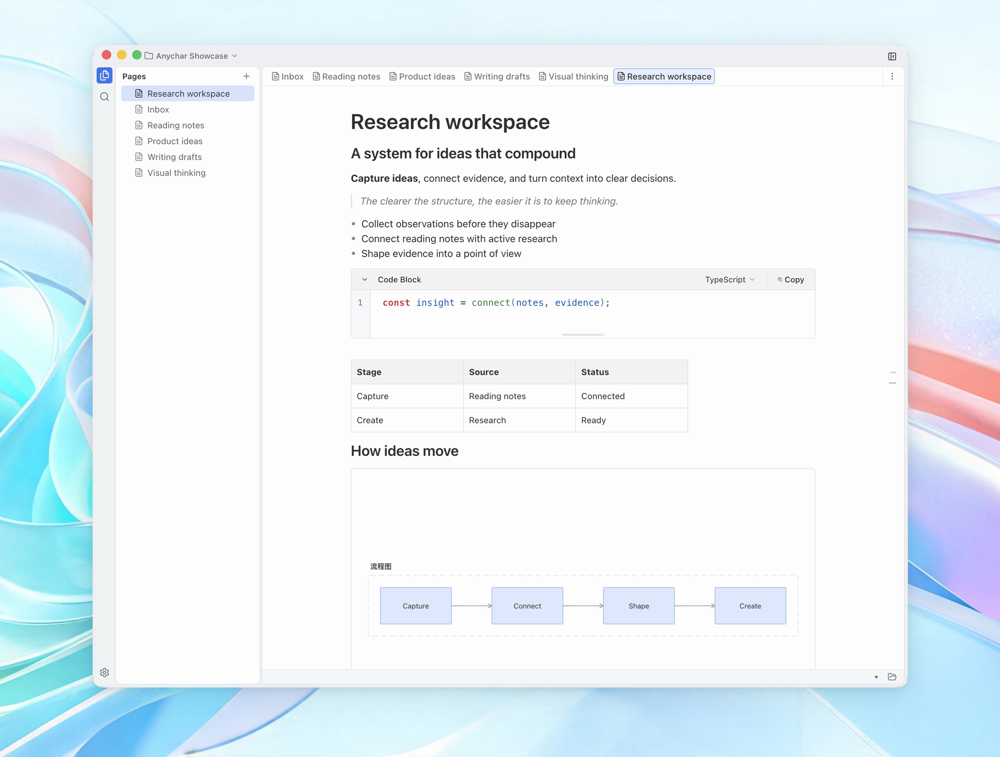

# Anychar

**For thinking, and creating.**

A local knowledge system to capture and organize ideas, AI-native by design.

[Website](https://anychar.com) · [Download](#download) · [Features](#features) · [Report a bug](https://github.com/anychar/anychar/issues/new)

## Download

| Platform | Architecture         | Download                                                                                                |
| -------- | -------------------- | ------------------------------------------------------------------------------------------------------- |
| macOS    | Apple Silicon        | [Download DMG](https://github.com/anychar/anychar/releases/download/v0.1.2/Anychar-0.1.2-mac-arm64.dmg) |
| macOS    | Intel                | [Download DMG](https://github.com/anychar/anychar/releases/download/v0.1.2/Anychar-0.1.2-mac-x64.dmg)   |
| Windows  | 64-bit · Intel / AMD | [Install for Windows](https://get.microsoft.com/installer/download/9PDVTVSLBLTZ?referrer=appbadge)      |

For guided downloads and chip selection help, visit [anychar.com/en/download](https://anychar.com/en/download). Older versions and release notes are available under [all releases](https://github.com/anychar/anychar/releases).

## Features

- **Flexible blocks** — Mix headings, quotes, lists, code, tables, and images.
- **Full-text search** — Search titles and content from one phrase.
- **Drawing** — Add an editable drawing canvas directly inside a page.
- **Document history** — Compare changes, restore a version, or keep a copy.

## Your knowledge stays on your device

Anychar stores your workspace locally. Back it up on your terms, recover changes with page history, and decide when AI can access it.
